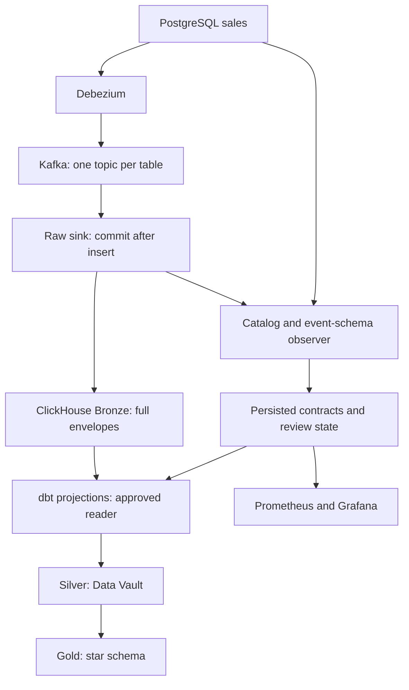

> Publication holds are now scoped to affected source projections and dependent dbt models. Independent branches continue, with separate watermarks. See [scoped holds](scoped-holds.md).

# Architecture, contracts and ownership

The ETag variant is detailed in [etag-architecture.md](etag-architecture.md), with actual service responsibilities and CDC, monitoring, approval and transformation flows.

## Data flow

PostgreSQL Debezium does not provide a general DDL event topic. Five-second catalog polling detects changes even on empty tables. Embedded Kafka Connect JSON schemas detect actual event shapes as they first appear. A change followed by a reversal between polls can be missed if it produces no event: CI migration checks remain necessary.

There is no Avro Schema Registry dependency in the main pipeline. Full embedded Connect JSON schemas are preserved. A SHA-256 fingerprint identifies each event schema; a bounded cache avoids repeating compatibility analysis/control-database lookup for an already-seen version. Computing a fingerprint still costs hashing/serialization of schema bytes: this is deliberately visible and less efficient than carrying a preassigned schema ID. Optional Registry exercises show the ID-based alternative without pretending the JSON producer emits Avro.

## Three different contracts

1. **Capture contract:** can connector/serializer/sink capture the source change? A permissive Bronze cannot repair events that never reached Kafka. Connector status and lag must be monitored too.
2. **Reader contract:** required names/types/nullability/identity supported by the current projection. Catalog checks are conservative, not a complete Avro compatibility algorithm.
3. **Business contract:** units, meaning, freshness, completeness and correct dimensional relationships. Same-type changes may need explicit metadata and business tests.

Catalog changes are persisted once per `(entity,fingerprint)`. Technical compatibility of an additive change allows the old projection to continue, but keeps an unresolved review. Approval explicitly records a new mapping version and updates the accepted source contract; it never silently backfills.

Approval in this demo resolves outstanding changes as a batch. In production use individual change IDs, named reviewers, reason, effective time and linked migration/consumer releases. The API is a localhost educational API without authentication.

## Failure behavior

| Situation | Hybrid | Strict |
|---|---|---|
| Added optional field | Raw continues; old Gold mapping continues; review open | Same: additive is reader-compatible |
| Breaking source/event contract | Raw continues; new dbt builds refused | Raw sink holds commits; Kafka retains backlog; builds refused |
| Bad numeric value in approved text field | Raw continues; projected-data test prevents downstream rebuild | Same: a schema check alone cannot detect bad values |
| ClickHouse/control DB unavailable | Sink retries uncommitted batch | Same |
| New malformed envelope | Sink retries, no offset advancement | Same |

The strict branch intentionally demonstrates coupling: a single breaking change can hold the sink batch, including other tables. For production isolation use per-domain workers/consumers and affected-model publication gates. The hybrid/etag build gate isolates affected model branches; see scoped-holds.md. Connector itself continues producing in strict mode; it is sink consumption that stops, not a claim that source CDC always crashes.

A commit can fail after ClickHouse insert succeeds. Raw duplicates are allowed. Explicit amount corrections are stored separately in append-only `ops.event_repairs`; latest approved correction per transport event changes projection interpretation while original raw bytes remain intact. Stable `event_id = topic:partition:offset` deduplicates projection records. This is at-least-once ingestion, not distributed exactly-once. Original key, schema, complete envelope, payload, operation, LSN, source time and ingestion time are retained, including tombstones. `REPLICA IDENTITY FULL` supplies before values for delete demos.

One Kafka partition per table plus source LSN/offset gives deterministic table-level order. No global cross-table transaction-consistent snapshot is claimed. Primary-key changes break the catalog contract and require a different identity/reconciliation design.

## Silver tables

| Table | Grain / purpose |
|---|---|
| `stg_customers`, `stg_orders` | One projected CDC event; idempotent by event_id; mapping_version records interpretation |
| `hub_customer` | Customer business key, immutable customer hash key, first observed load time/source |
| `hub_order` | Order business key, immutable order hash key |
| `lnk_order_customer` | Immutable observed order/customer association |
| `sat_customer_details` | Changed descriptive customer states, including deletion |
| `sat_order_details` | Changed descriptive order states; amount, currency, status, country and date |
| `sat_order_customer_effectivity` | Ordered events selecting which relationship is current, including deletion |

Satellites suppress consecutive identical hashdiff states but preserve A→B→A. Ordering is source LSN then Kafka offset. `load_ts` is arrival/load time, not proof of business-effective validity. This is a compact Data Vault teaching model; production business-time corrections, PIT/bridge structures and late historical semantic changes need explicit rules.

The raw vault here is derived/rebuilt from projected event history, so replay can change existing satellite interpretation. It is not an immutable audited Raw Vault with versioned business-vault corrections. Hubs/links are logically immutable business identities, but their physical dbt tables are rebuilt for simplicity.

## Gold tables

`fact_order` has one current, nondeleted order: order_sk/order_id, customer_sk, date_sk, country_sk, currency_sk, amount, status, mapping_version.

- `dim_customer`: latest customer attributes (Type 1 for this lab).
- `dim_date`: order dates, year/month/day.
- `dim_country`: known countries plus UNKNOWN.
- `dim_currency`: currency codes.
- `revenue_by_country`: report over the star, grouped by date/country/currency; currencies are never summed together as one revenue unit.

Data Vault history is available in Silver; Gold intentionally uses current order state and Type-1 customer attributes. This does not claim an as-of-sale SCD2 star.

## Two deployment responsibilities

| Team | Owns | PR gate |
|---|---|---|
| Source domain | Source migrations, business meaning, expand/contract window | Schema diff, identity checks, notify consuming owners |
| CDC/platform | Connector, capture coverage, raw retention, offsets/replay durability | Capture/sink integration test |
| Analytics/DE | Reader mapping, Vault/star models, data tests, replay plan | dbt parse/build/test and historical replay test |

Not every additive field requires a CDC deployment. A required rename/type change needs a reader rollout and coordinated source migration. Reviews are mandatory for breaking/business changes; compatible additions can be checked automatically but must have an explicit “ignore / future only / backfill” decision.

Gold tables are rebuilt individually by dbt and are not atomically published as a group. Existing Gold remains untouched when the pre-projection contract gate refuses a build or the pre-downstream amount test fails. A failure halfway through downstream rebuilding can leave mixed model generations. Production publication should build/test an isolated generation and switch readers only after success. This limitation is explicit rather than hidden behind a green ingestion status.
