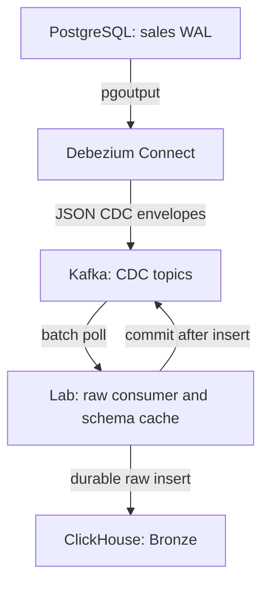
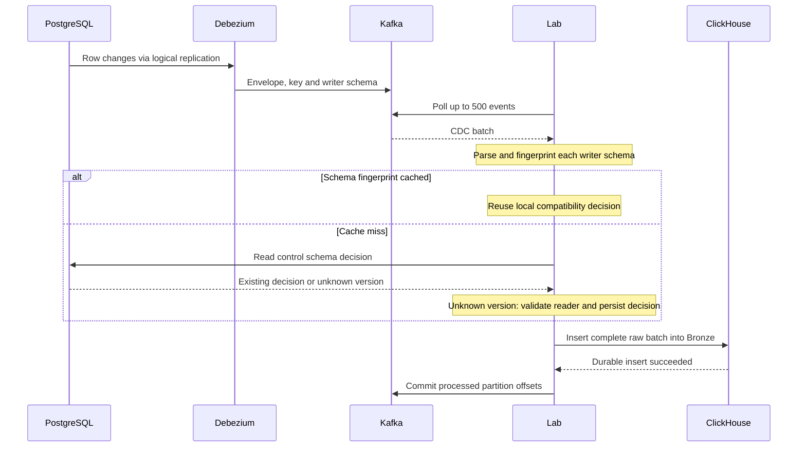
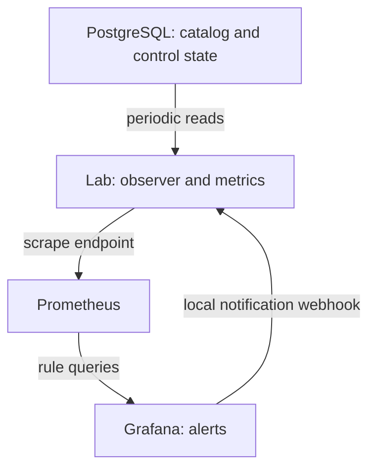
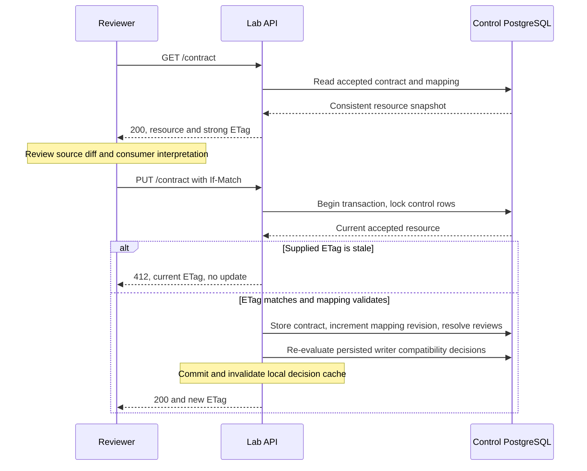

# ETag variant: services, CDC flow and contract control

This describes the **actual runnable lab**, not a hypothetical registry-backed implementation. The variant reuses the ordinary CDC transport. ETag introduces a contract approval protocol and configurable schema preconditions around transformation/publication.

## Services and responsibility boundaries

| Compose service | Responsibility in the ETag variant |
|---|---|
| `source` (PostgreSQL) | `sales.*` source data, logical replication/WAL, current table catalog; also `control.*` contract/mapping/settings, schema decisions, review state and run history |
| `connect` (Debezium/Kafka Connect) | Reads PostgreSQL `pgoutput`; emits row changes with embedded Connect JSON schemas into Kafka. Maintains its own source offsets. Does not call `/contract` or enforce ETags |
| `kafka` | Durable CDC topics `lab.sales.customers` and `lab.sales.orders`, Connect internal topics and raw-consumer committed offsets. Does not validate the lab ETag |
| `lab` | One FastAPI process containing raw-consumer and monitoring threads, schema cache/observer, contract API, data generator/demo migration handlers and pipeline runner |
| `clickhouse` | Bronze full envelopes; Silver projected events/Data Vault; Gold dimensions/facts/reports; query-log cost measurements and explicit correction records |
| `airflow` | Scheduled/manual orchestration: HTTP POST `/build` on lab. dbt actually executes as a subprocess inside lab, not in the Airflow container |
| `airflow-db` | Airflow metadata only; separate from source/control PostgreSQL and ClickHouse |
| `prometheus` | Scrapes `/metrics` from lab every five seconds |
| `grafana` | Displays metrics, evaluates alert rules and notifies the configured contact point. Lab receives local webhook notifications at `/alert-receiver` |
| `schema-registry` (optional profile) | Separate Avro compatibility API exercise. It is **not** on the active Debezium JSON CDC path |

The raw sink, observer, contract API and runner are modules/threads in **one lab container**, not four independently deployed services. The consumer-decision cache is process-local. `control.*` is outside the captured table list, so approving a contract does not feed control writes back into the sales CDC topics.

## CDC transport topology



This topology stays the same in `hybrid`, `strict` and `etag` modes. In `etag`, hold/warn/off config changes the transformation decision; raw capture continues. In `strict`, the raw consumer can hold commits on an unresolved breaking contract.

## What happens to one CDC batch?



No HTTP contract call occurs in that event sequence. The PostgreSQL access on a cache miss is a direct database request. Additional mode/control reads happen per batch. ClickHouse transport itself uses HTTP through its client library; “no per-event schema REST validation” does not mean “no HTTP anywhere”.

The per-event fingerprint is of the embedded schema; not of the row values. Schema lookup does not validate every amount or business invariant. Projected-data tests do that later. A commit failure after insert may duplicate raw rows; `topic:partition:offset` deduplicates projections.

## Background schema observation and alarms

The monitoring thread in lab runs approximately every five seconds:

1. Reads PostgreSQL catalog (including empty tables) and accepted contract.
2. Computes a diff and persists previously unseen changes in `control.changes`.
3. In etag mode, evaluates exact source-contract equality according to hold/warn/off policy.
4. Exposes the result and review/freshness/cost metrics on `/metrics`.
5. Prometheus scrapes; Grafana evaluates its rules and delivers notifications.



Actual event-schema discovery also happens in the raw consumer. Catalog polling and event-schema discovery complement each other; PostgreSQL Debezium does not emit a generic DDL change-event stream.

## Why a compatible addition can alert without stopping CDC

Suppose `delivery_channel` is added:

- The source catalog changes and later UPDATE messages carry the new optional field.
- Existing reader still understands all required fields: **reader-compatible**.
- Exact observed schema is different from the reviewed contract: **precondition mismatch**.
- `hold`: raw is saved, next Gold build refused.
- `warn`: raw is saved, compatible old-reader build allowed, mismatch alert remains.
- `off`: equality guard disabled; ordinary breaking-change and value-quality gates remain.

A breaking reader change can still stop publication in warn/off. Those policies disable or soften exact equality, not all correctness checks.

## HTTP ETag resource and conditional approval

The HTTP resource is the **accepted contract plus reader mapping**. Its strong ETag hashes that representation, including semantic mapping settings and monotonic mapping.version. It is not the hash of the current source catalog alone, and is not the fingerprint placed on every CDC event.

Therefore adding a source column can make `schema_etag_precondition_failed=1` while GET `/contract` still returns the previous ETag: the reviewed resource has not changed yet. The ETag changes when an approval updates that resource.



Missing validator on conditional PUT produces 428. A second reviewer using the old token gets 412. Checks/writes are inside a row-locked transaction rather than a read-compare-write sequence without synchronization. Source DDL remains external: this is optimistic concurrency for approval, not a distributed transaction with source deployment.

Approval accepts the actual source schema after mapping validation; it does not automatically add every source field to analytical tables. For `delivery_channel`, the explicit mapping flag plus deployed dbt model changes and replay are required.

## Where Airflow and dbt enter

```mermaid
sequenceDiagram
    participant A as Airflow or CLI
    participant L as Lab runner
    participant P as PostgreSQL
    participant C as ClickHouse
    A->>L: POST /build, mode and optional replay bounds
    L->>P: Read catalog, accepted contract and run settings
    alt Hold-mode exact mismatch or unresolved breaking change
        L-->>A: 409, publication refused
        Note over C: No model build starts; Bronze ingestion continues
    else Publication may proceed
        Note over L: Freeze cutoff and reader revision for the run
        L->>C: dbt project raw events into staging
        L->>C: Run staging-only validation tests
        L->>C: Build Vault and Gold models
        L->>C: Run complete validation tests
        L->>P: Record success and normal cursor if incremental
        L->>C: Collect tagged query-log read costs
        L-->>A: Run result and measurements
    end
```

The actual runner executes separate dbt subprocesses, not one SQL transaction. Global lab locks coordinate approval/build. The shared ingestion lock prevents an older-timestamp in-flight batch from racing cutoff capture. Gold is not atomically switched as one generation; a later model failure can leave a partial rebuild. Production would use a validated isolated generation and atomic publication boundary.

## After successful approval

1. Approved catalog now matches source: equality metric clears on the next observation.
2. Old cache decisions are invalidated; persisted decisions reflect the new reader.
3. Grafana observes the cleared signal and resolves the alert on its next evaluation.
4. A build uses the approved mapping revision.
5. Held, never-projected events are normally processed by the next incremental build.
6. Already-projected events that ignored a captured field require replay/backfill.
7. Events that never contained a field cannot produce historical values by replay alone.

For channel rollout, this version uses full replay from Bronze. The existing country-targeted selector is not a generic schema-evolution recovery algorithm.

## Production separation, if the system grows

The lab bundles roles for clarity. They can be split into raw-ingestion workers, a contract-control service, schema observers and transformation workers. Carry schema IDs in events; cache schema definitions and reader-revision-specific decisions in workers; publish approved-revision notifications to a control topic. Use conditional GET for occasional reconciliation. Add distributed build leases, per-domain isolation and atomic report publication.

These are proposed extensions, not already implemented services. Schema Registry, ETags and Kafka delivery semantics solve different problems and should not be described as one end-to-end exactly-once contract protocol.
