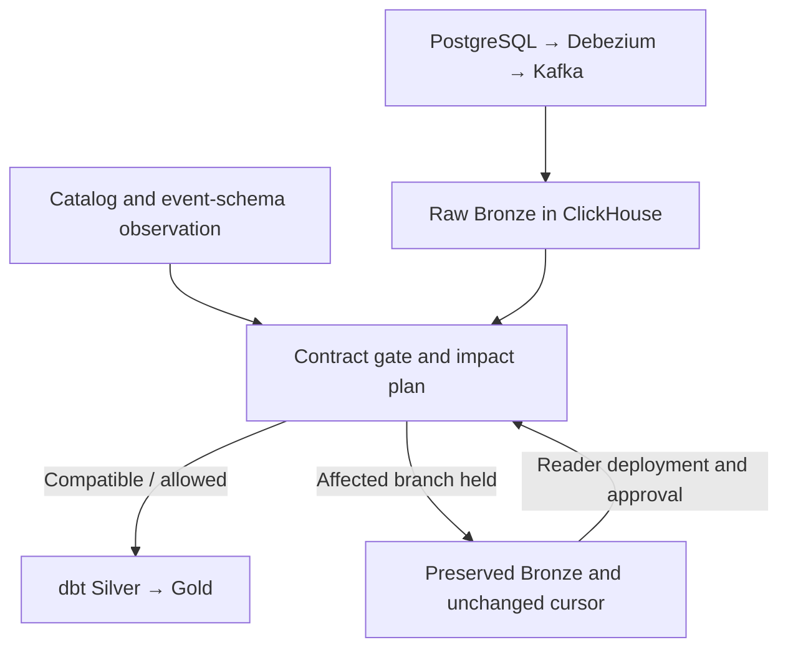
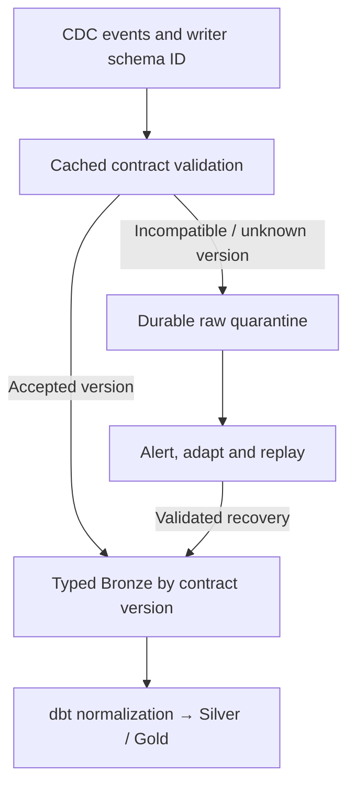

# Hybrid schema evolution: implementation and design tradeoffs

This lab uses **schema-on-read as its ingestion foundation, with contract checks before dbt transformation**. It preserves complete CDC events in raw Bronze and applies an approved analytical reader when building Silver/Gold. The contract gate holds affected branches rather than rejecting all incoming raw events.

A schema-on-write foundation can also support a hybrid design. It requires an explicit policy for incompatible events, such as durable quarantine plus replay or multiple accepted writer-schema versions. That alternative is described below as a proposed architecture, not an implemented feature of this repository.

## Terminology and boundaries

| Term | Meaning in this document |
|---|---|
| Schema-on-read | Preserve source payloads without requiring their business fields to match one approved relational projection at ingestion. Interpret business fields later. |
| Schema-on-write | Validate business payload structure/types against an accepted writer contract before inserting into the primary typed landing representation. |
| Hybrid | Different enforcement policies at different boundaries, with durable preservation, compatibility checks, isolation and recovery. It is not a distinct storage format. |
| Contract approval | Accept a source catalog and analytical mapping after review; not an automatic model deployment or historical rewrite. |
| Replay/backfill | Reinterpret previously stored events or fetch missing information. Cannot invent values absent from all retained sources. |

Bronze itself has a fixed envelope/metadata table schema. Calling this design schema-on-read refers to the **source business payload**, stored as JSON strings, not an absence of all storage schemas. PostgreSQL source constraints and CDC decoding still exist.

## What this repository implements

The arrows represent data/control decisions. The gate does not move raw rows into a separate queue, and approval does not automatically deploy code.

### 1. Capture and preserve events

PostgreSQL is the source. Debezium captures WAL changes, Kafka buffers them, and the [lab sink](../app/sink.py) inserts complete envelopes and metadata into [bronze.events](../infra/clickhouse/init.sql). Kafka commits occur after the batch insert.

In `hybrid` and `etag` modes, business-schema incompatibility does not prevent raw capture. At-least-once delivery can produce duplicate physical rows; [staging](../dbt/models/silver/stg_orders.sql) deduplicates by event_id, derived from topic/partition/offset. This is not an end-to-end exactly-once claim.

The separate `strict` demonstration can hold the shared consumer batch before offset commits. It has no durable quarantine implementation, so it demonstrates ingestion coupling rather than the proposed schema-on-write hybrid below.

### 2. Observe catalog and event compatibility

The [observer](../app/observer.py) runs inside the same lab service as the API, sink and dbt runner. The background monitor polls approximately every five seconds; each build scans the catalog again. It detects additions, removals, type changes, loosened nullability and changed PK membership.

The sink also registers previously unseen embedded event-schema fingerprints and checks required reader fields/types. Decisions are persisted and cached locally; there is no per-event REST ETag validation request. Catalog and event checks serve different purposes: current catalog state alone does not describe all historical event versions.

The approved catalog, mapping, changes, event-schema decisions and run metadata live in PostgreSQL `control.*`, in the same source database in this lab. This simplifies setup but couples control availability to source availability. [Storage](../app/storage.py) shows the actual database access.

### 3. Decide before starting affected dbt work

The [impact planner](../app/impact.py) binds source tables to staging models and follows model dependencies. The [runner](../app/pipeline.py) chooses explicit runnable model names and uses cautious indirect test selection.

| Situation | Classic hybrid decision | Consequence |
|---|---|---|
| Compatible additive field | Continue existing reader; register review | New field remains in raw, but is not automatically visible in Silver/Gold. |
| Required field removed or changed incompatibly | Hold affected projection and descendants | Independent branches continue; accumulated raw events remain available. |
| PK membership or required nullability changes | Hold for contract review | Existing data tests need not fail merely because DDL changed. |
| Explicit semantic migration marker | Hold affected branch | Units/meaning cannot be inferred from structural schema equality. |
| Valid schema but invalid amount data | Run staging, then fail valid_amount | This is a data test failure, not a schema gate decision. |

Customer changes can hold shared facts/reports because [fact_order](../dbt/models/gold/fact_order.sql) explicitly depends on dim_customer. An order change leaves customer staging/Vault/dimension eligible. The shared raw view is not treated as grounds to hold every descendant indiscriminately.

Dependency discovery scans this lab's literal `ref()` calls, including depends_on comments. Dynamic Jinja refs and larger projects should use a compiled dbt manifest and an explicit deployment-owned source binding registry. This is table/model isolation, not column lineage.

### 4. Keep independent watermarks

Each source projection has an ingestion cursor in `control.settings.entity_cursors`. Successful eligible branches advance; held branches retain their old position. A successful customers build therefore cannot skip unprocessed orders. The [event filter](../dbt/macros/event_filter.sql) applies the corresponding cursor and frozen cutoff.

A partially held build returns `partial_success`; when both source projections are held it returns 409. Global Gold freshness advances only after an entirely unheld successful build. Run output and `/state` contain the impact plan. [Metrics](../app/metrics.py) and [Grafana rules](../infra/grafana/provisioning/alerting/rules.yml) expose source table, fields, models and held status.

### 5. Deploy, approve and recover

For a supported evolution:

1. Review source structure, business semantics and downstream dependencies.
2. Deploy a reader/model that supports the new events and any retained historical versions.
3. Approve the catalog/mapping. Approval resolves reviews and invalidates cached event decisions.
4. Run the eligible branch and validate business results.
5. Replay events already processed under an older mapping when the new analytical field must become historically visible.

The distinction in step 5 matters:

- **Held, never projected events:** processing can resume from the unchanged cursor with the new reader; no separate historical replay is needed for those events.
- **Already projected under the old reader:** approval alone does not rewrite them. They require replay/backfill.
- **Field absent from historical events:** replay is insufficient. Enrichment or historical source data is necessary, and current values may not describe historical truth.

The country comparison measures projection, downstream, validation and overhead reads from the same baseline/cutoff. Even a cheap targeted projection may provide limited total savings when downstream models are rebuilt in full. See [backfill](backfill.md).

## Why ETag is optional here

The base hybrid already checks compatibility and holds breaking branches. [ETag mode](etag-preconditions.md) adds two separate controls:

- `hold/warn/off` governs exact catalog equality, including reader-compatible additions.
- Conditional approval with `If-Match` prevents a reviewer from overwriting a contract/mapping revision that changed after they fetched it.

A strong resource ETag includes the approved contract and analytical mapping. It protects approval concurrency, not source DDL transactions, Kafka delivery or business semantics. Exact mismatch and reader incompatibility are not equivalent: an additive field can be safe to read and still fail exact equality. Warn continues compatible data through the current reader; it does not authorize breaking data.

## Advantages of the implemented schema-on-read foundation

- **Simple preservation path:** one raw event store, without a primary/quarantine routing protocol or reinsertion process.
- **CDC continuity:** breaking business schemas do not block raw ingestion in hybrid/etag modes.
- **Branch isolation:** compatible domains continue; shared downstream dependencies are held deliberately.
- **Recoverable interpretation:** deploy a revised reader and replay retained events without querying the source for fields already captured.
- **Inspectable history:** original envelopes remain unchanged; explicit amount repairs carry separate reasons and timestamps.
- **Measurable recovery work:** full/targeted comparisons distinguish raw projection cost from downstream rebuild and validation.

## Disadvantages and current limits

- **Visibility can lag preservation:** new data can be stored safely yet remain absent from Gold. Additive review, field-specific debt metrics and business checks are needed; not every field is covered by this lab's country metric.
- **Storage and replay cost:** retaining raw history and rebuilding models consumes space, CPU and reads. Retention must exceed the practical discovery/repair window.
- **Reader complexity:** renames, type changes and semantics require interpreting historical writer versions. One global unit conversion is not valid for mixed-unit history.
- **Finite isolation:** table/model holds are conservative. Some safe columns in an affected model could still be processed with richer column lineage, which is not implemented.
- **No atomic publication generation:** dbt commands are separate operations. A later SQL/test failure can leave some models rebuilt and others unchanged; held schemas are isolated, arbitrary execution failures are not independently contained per branch.
- **Lab-level concurrency:** process locks coordinate builds/approval in one instance. There is no distributed lease for multiple runners or transaction spanning source DDL, control state and warehouse publication.
- **Operational ownership remains necessary:** alert acknowledgment is not model adaptation. CDC/source and dbt teams need a coordinated review/deployment procedure.
- **Observability has aggregate limits:** global freshness/backlog may look stale during healthy independent work. Scoped impact and per-entity cursors explain it; full per-model freshness/backlog instrumentation is not implemented.

## A hybrid with schema-on-write as the foundation

The following is a **proposed alternative**, not a description of existing lab behavior. Its primary landing representation accepts only events conforming to an approved writer contract. Incompatible events still need a durable fallback.

### Acceptance path

1. An event carries an identifiable writer schema/version plus durable event identity and ordering metadata.
2. The sink resolves that version against an approved contract, caching immutable schema lookups by ID. Cache invalidation/versioning must also cover mutable approval policies.
3. Accepted events go into a typed landing table or version-specific typed tables.
4. dbt normalizes accepted versions into a stable Silver model, then publishes Gold after data tests.

A versioned approach allows v1 and v2 to coexist. It avoids immediate rejection during a coordinated migration, but readers must support both, and semantic changes still need explicit version/effective-time interpretation. A Schema Registry compatibility rule is one input; it does not prove downstream business compatibility.

### Incompatibility and durable preservation

An incompatible event is stored in quarantine with the **original envelope, writer schema/version, source/table, event identity, ordering metadata and rejection reason**. Alert the source and data owners with affected models.

Commit the consumption position only when that event has been durably handled through the accepted or quarantine path. Primary/quarantine routing must tolerate crashes and retries; with separate stores it needs idempotent writes and recovery tracking, not an assumed cross-system transaction. Kafka-based transactional routing can address a Kafka-only boundary, but does not automatically make external warehouse writes atomic.

For dependent analytics, an unresolved quarantine entry is a **gap**, not permission to claim the whole domain is current. One option is to hold that source's publication watermark while capturing its later events and allowing independent domains to proceed. Another is to queue later events of that entity until the gap is repaired. Advancing past rejected events without tracking gaps can silently lose analytical coverage.

### Adaptation and replay

1. Owners review the rejected version and deploy accepted contract/typed-table/reader changes.
2. Revalidate quarantine entries against the revised policy.
3. Replay deterministically, deduplicating by original event identity.
4. Preserve source ordering and handle late arrivals. Inserting an older event after a newer one must not overwrite current state incorrectly; history-aware normalization must select the correct version.
5. Mark each recovered event/gap explicitly, validate dependent models, and release the domain's publication watermark.

A dead letter queue that is routinely deleted without accounting for rejected data does not satisfy this design. Quarantine needs ownership, retention, reconciliation and a supported recovery procedure. Selectively quarantining a domain also requires handling its cross-domain dependencies.

### Advantages

- **Early explicit enforcement:** incorrect business structures cannot enter the primary typed path unnoticed.
- **Clear typed boundaries:** accepted versions and their types are visible before dbt normalization.
- **Targeted exception handling:** isolated incompatible events can be investigated and replayed without scanning all raw history.
- **Controlled migrations:** multiple accepted writer versions can support gradual producer rollout.

### Disadvantages

- **More infrastructure and state:** versioned typed storage, quarantine, routing, schema/policy cache, gap tracking and replay lifecycle.
- **Harder correctness:** crash-safe routing, deduplication, ordering and commit/publication positions must stay consistent across two paths.
- **Tighter producer/consumer coordination:** deploying a new source schema before the accepted writer policy is ready creates quarantine or an outage.
- **Quarantine can become neglected debt:** storing rejected messages is not enough; missing events must remain visible in coverage/freshness reporting.
- **Recovery can still be expensive:** a targeted event replay may require broad downstream recomputation. If accepted events discarded unmapped fields, a new analytical field also needs a complete raw archive or source backfill.
- **Semantic validation remains external:** compatible types do not establish compatible units, business identities or historical interpretation.

## Comparing the choices

| Dimension | Implemented raw-first hybrid | Proposed typed-first hybrid |
|---|---|---|
| Main ingestion foundation | Schema-on-read business payload | Schema-on-write business payload |
| First durable destination | Shared complete raw Bronze | Typed accepted path or durable raw quarantine |
| Structural gate | Before affected dbt work, plus observation during ingestion | Before the primary typed write |
| Incompatible events | Stay in Bronze; projection cursor held | Quarantined with explicit gaps/recovery state |
| Compatible additions | Old reader can proceed; review/backfill may be needed | Must fit an accepted writer version/policy; normalization can still omit fields |
| Independent domains | Scoped dbt model selection | Scoped routing/consumers plus dependency-aware publication |
| Recovery complexity | Reader adaptation and bounded raw replay | Contract/table adaptation, reinsertion, ordering and reconciliation |
| Data visibility risk | Captured but unprojected fields | Quarantined or omitted fields masked by a healthy primary path |
| Main cost | Raw retention and replay/downstream rebuild | Typed evolution and dual-path operations, plus replay/downstream rebuild |
| Hybrid aspect | Flexible raw capture with enforced analytical contract | Enforced primary writes with flexible raw fallback or multiple writer versions |

For this educational project, raw-first is simpler because preservation, backlog and replay use one store. Typed-first is plausible where a typed ingestion boundary is a requirement, provided quarantine and recovery are treated as first-class behavior. Neither foundation removes the need to monitor analytical visibility, coordinate changes or budget for historical recomputation.

## Team workflow

Source owners document schema and semantic changes, including expected rollout and historical meaning. CDC/platform owners assess capture, storage and compatibility; data owners assess dbt mappings, dependency impact, tests and replay cost. A schema PR review is useful, but runtime drift detection still catches manual DDL and uncoordinated changes.

A coordinated change should leave a reviewable plan: supported old/new writer versions, deployment order, affected models, alert owner, recovery bounds, retention window and validation queries. This lab provides the technical exercises and local alerts; it does not implement a production approval/governance system.

Related exercises: [rename](demo-guide.md#2-rename-hold-orders-continue-customers), [invalid data](demo-guide.md#4-type-change-invalid-history-and-audited-repair), [PK/nullability](demo-guide.md#9-primary-key-and-nullability-schema-holds-before-tests), [ETag hold](demo-guide.md#11-etag-hold-conditional-approval-428412-and-recovery), and [warn](demo-guide.md#12-warn-compatible-drift-uses-the-old-reader).
